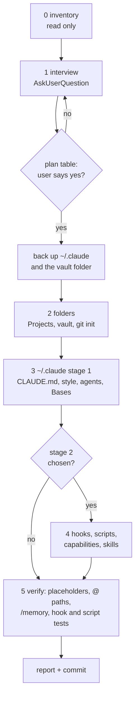

# BOOTSTRAP: instructions for the setup agent

You are setting up a Claude Code working environment for your user, modelled on the blueprint in this folder. Read `docs/architecture.md` and `docs/prompting-strategies.md` before you start; they explain why each file exists, and you will need that to adapt it rather than copy it.



## Ground rules

- Never overwrite an existing file without a backup. Before phase 3, copy any existing `~/.claude/` to `~/.claude.bak-<YYYY-MM-DD>/`, and do the same for a vault folder you would write into.
- Every `<<PLACEHOLDER>>` in `payload/` is filled from the interview; machine facts come from the phase 0 inventory (`<<HARDWARE>>`, `<<OS>>`, `<<SHELL>>`, `<<SHELL_CONFIG_PATH>>`, `<<PACKAGE_MANAGERS>>`, `<<FIRST_PACKAGE_MANAGER>>`, `<<SCRIPT_LANGUAGE>>`, `<<RUNTIMES>>`, `<<SHELL_QUIRKS>>`, `<<OTHER_PATHS>>`, `<<EDITORS>>`; confirm them with the user in one question), and any placeholder that neither covers is one more interview question. Never leave one in an installed file; `rg '<<[A-Z_]+>>' ~/.claude <vault>` must return nothing at the end.
- Text in `payload/` that names Joris, his clients, his servers or his tools is an example of the pattern. Replace it with your user's equivalent or delete it. Do not install another person's rules verbatim.
- Show the plan (a table: path, action, source) and get a yes before phase 3. After that, reversible local work needs no further confirmation.
- Use the package managers already on the machine. Ask before installing anything system-wide.

## Phase 0: inventory (read only)

Report in one table:

- OS, shell, and which of `git`, `rg`, `jq`, `bun`/`node`, `uv`/`python3`, `gh`, `obsidian` are installed.
- Does `~/.claude/` exist? List `CLAUDE.md`, `settings.json`, `agents/`, `skills/`, `output-styles/`, `hooks/` and their sizes.
- Existing Obsidian vaults (look for folders containing `.obsidian/`, for example under `~/Documents`, `~/Obsidian`, iCloud).
- Does `~/Projects/` (or another code folder) exist, and how many git repos are in it (`find ~/Projects -maxdepth 2 -name .git | wc -l`)?

## Phase 1: interview

Ask with the AskUserQuestion tool, at most 4 questions per call, a recommended option first. Collect:

| placeholder | question |
|---|---|
| `<<NAME>>` | What should agents call you? |
| `<<ROLE>>` | What do you do (one line), and what do you mostly build? |
| `<<STACK>>` | Main languages, frameworks, package managers, in order of preference |
| `<<REPLY_LANGUAGE>>`, `<<CODE_LANGUAGE>>`, `<<CLIENT_LANGUAGE>>` | Language for replies; for code and commit messages; for UI strings and anything a client reads |
| `<<REPLY_PREFERENCES>>`, `<<PATTERNS>>`, `<<HARD_NOS>>` | How replies should read; working patterns the agent should compensate for (e.g. loses context between sessions); things an agent must never do |
| `<<VAULT>>` | Absolute path of the vault: an existing one, or a new one (recommend `~/Obsidian/<Name>`: **no spaces** in the path, so `@` imports resolve cleanly) |
| `<<AGENT_DIR>>` | Folder in the vault that holds the prompt files (recommend `Agent`, no spaces) |
| `<<PROJECTS>>` | Code folder (recommend `~/Projects`, one checkout per repo, flat) |
| `<<APPROVALS>>` | Which actions must always be asked first? Offer: messages to people, spend, deleting data, production deploys, pushes to main. Everything reversible is done without asking. |
| `<<STAGES>>` | Install stage 1 only (recommended), 1+2, or read about 3 as well |
| `<<SERVICES>>` | Which services agents will touch (GitHub, a chat tool, mail, a cloud host, a tracker). Each becomes a capability file in stage 2. |

## Phase 2: folders

1. `<<PROJECTS>>/` exists, flat: `<<PROJECTS>>/<repo>`. No nesting by client; the repo name carries it.
2. Vault: create or extend with this layout (skip folders the user already has under another name and map them instead):

```
<<VAULT>>/
  <<AGENT_DIR>>/        prompt files @-imported by ~/.claude/CLAUDE.md (from payload/vault/Agent)
  Constitution/         vault-schema.md, documentation-temperaments.md (from payload/vault/Constitution)
  Projects/<Name>/      entry note, tracker.md, handoff.md, decisions.md, decisions/
  Network/              one note per person or organisation
  Resources/            reference material, untyped
  Timeline/             one daily note per day, DD-MM-YYYY.md
  Templates/            (from payload/vault/Templates)
  CLAUDE.md             vault-local rules (from payload/vault/CLAUDE.md)
```

3. `git init` the vault if it is not a repo, with a `.gitignore` holding `.obsidian/workspace*.json` and `.trash/`. Git is the audit log of every agent write.
4. Obsidian plugins to enable (ask first): **Tasks** (the task grammar), **Templater** (the templates), Bases is built in. Optional: Calendar.

## Phase 3: ~/.claude (stage 1)

| source | destination | adapt |
|---|---|---|
| `payload/vault/Agent/*.md` | `<<VAULT>>/<<AGENT_DIR>>/` | fill placeholders; `machine-context.md` from the phase 0 inventory |
| `payload/vault/Projects/*.base`, `Network/`, `Timeline/` | same folders in the vault | Bases views; adjust `file.inFolder("...")` if the user's folders have other names |
| `payload/claude/CLAUDE.md` | `~/.claude/CLAUDE.md` | the `@` lines point at `<<VAULT>>/<<AGENT_DIR>>/`; merge with an existing file, keep its user rules |
| `payload/claude/output-styles/operational-spec.md` | `~/.claude/output-styles/` | name and language |
| `payload/claude/agents/*.md` | `~/.claude/agents/` | six workers; keep the role split (cheap model for read-only search and web research, strongest for execution, review and verification) |
| `payload/claude/skills/start/` | `~/.claude/skills/start/` | the session opener |
| `payload/claude/settings.json` | merge into `~/.claude/settings.json` | never replace an existing file; merge keys with `jq`. At stage 1 keep only `outputStyle` and `permissions`; the `hooks` block comes in phase 4 |

Then `git init ~/.claude` with a `.gitignore` that excludes everything except `CLAUDE.md`, `settings.json`, `dispatch-protocol.md`, `agents/`, `skills/`, `output-styles/`, `hooks/`, `capabilities/`, `scripts/` (Claude Code writes caches, transcripts and history there too; those stay out of git, and so does `~/.claude/scripts/config.json` if the user prefers).

## Phase 4: stage 2 (only if chosen)

Needs `bun` (scripts) and `jq` (hooks). Ask before installing either.

| source | destination | adapt |
|---|---|---|
| `payload/claude/hooks/` (with `tests/`) | `~/.claude/hooks/` | `chmod +x *.sh tests/*.sh`; replace `<<VAULT>>` in `vault-write-gate.sh`; in `outbound-ask.sh`, set the matcher list to the user's message-sending tools |
| `hooks` block of `payload/claude/settings.json` | merge into `~/.claude/settings.json` | paths stay `~/.claude/hooks/...` |
| `payload/claude/scripts/` | `~/.claude/scripts/` | copy `config.example.json` to `config.json` with `<<VAULT>>` and `<<PROJECTS>>` filled; tests stay alongside |
| `payload/claude/capabilities/` | `~/.claude/capabilities/` | one file per service from `<<SERVICES>>`, filled from `_TEMPLATE.md`, each with a `health` line you actually ran |
| `payload/claude/skills/{retro,memory-gc,prompt-audit}/` | `~/.claude/skills/` | none |
| `payload/claude/dispatch-protocol.md` | `~/.claude/dispatch-protocol.md` | add one routing line to `CLAUDE.md`: "An agent dispatched to run unattended: `dispatch-protocol.md`" |

What each script answers: `payload/claude/scripts/README.md`.

## Phase 5: verify (each check could fail; report its output)

1. `rg '<<[A-Z_]+>>' ~/.claude <<VAULT>> --glob '!*.test.*' --glob '!tests/'` → no hits.
2. Every `@` path in `~/.claude/CLAUDE.md` exists: `rg -o '^@(\S+)' -r '$1' ~/.claude/CLAUDE.md | sed "s|^~|$HOME|" | xargs -I{} test -f {} && echo ok`.
3. Ask the user to start a fresh `claude` session in `<<PROJECTS>>` and run `/memory`: the imported vault files must be listed. Then ask it "which agent types can you spawn?": the typed workers must be named.
4. Stage 2: `bash ~/.claude/hooks/tests/run-all.sh` → last line `failing: 0`; `bun test ~/.claude/scripts` → `0 fail`; `bun ~/.claude/scripts/doctor.ts` → one row per capability; `bun ~/.claude/scripts/vault-lint.ts --summary` → one summary line.
5. Obsidian: open `Projects/index.base`; the user's projects are listed.
6. `git -C ~/.claude status` and `git -C <<VAULT>> status`: commit the setup by path, one commit each.

## Report

End with: what was installed (paths), what was skipped and why, the verification output, and the three things the user should do in the first week (see `docs/architecture.md`, "First week").
