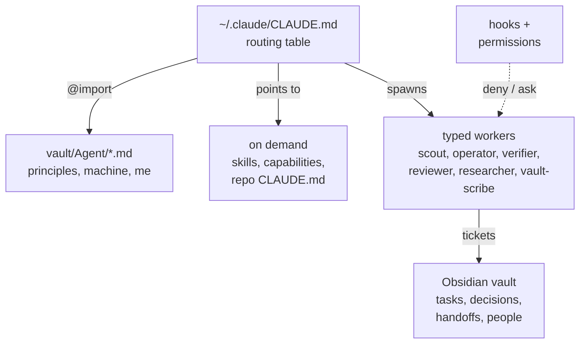

# Jig

**Agents do the work. You make the decisions.**

[](https://github.com/j-shelfwood/jig/actions/workflows/check.yml)

Jig is an operating method for working with AI agents, and the kit that runs it: [Claude Code](https://code.claude.com/docs/en/overview) as a team of typed agents, with an Obsidian vault as their shared memory. In woodworking, a jig guides every cut so the result is repeatable; this one does that for agent output. **You don't install it by hand: you give it to your own Claude Code agent, which interviews you and builds the setup on your machine.**

It is extracted from a setup used every day for freelance software work across several client projects. Every personal value was replaced by a `<<PLACEHOLDER>>`, and every rule keeps the reason (often a measured failure rate) that made it necessary.

## Quick start

```sh
git clone https://github.com/j-shelfwood/jig.git ~/Projects/jig
cd ~/Projects/jig
claude
```

Then type:

> Read BOOTSTRAP.md and set up my machine following it. Interview me first.

The agent takes an inventory (read only), asks you about ten questions, shows a plan table and waits for your yes. It backs up anything it would overwrite, installs, then runs checks that could fail and shows you their output.

Don't clone this inside an Obsidian vault: the templates would show up as real notes.

## What you get



| stage | contents | where |
|---|---|---|
| 1. Core | a global `CLAUDE.md` that `@`-imports your working rules from your vault; an output style; six typed workers; a session-start skill; a vault schema with templates and Bases views | `payload/claude/`, `payload/vault/` |
| 2. Guardrails | 7 hooks with fixture tests (typed spawns only, vault write gate, push guard, destructive git, operator report gate, outbound ask, session-start doctor); 4 bun scripts (agent queue, vault lint, capability doctor, transcript trace); skills for a weekly retro, memory cleanup and prompt audits; a capability registry; a dispatch contract for unattended agents | `payload/claude/hooks/`, `payload/claude/scripts/`, `payload/claude/skills/` |
| 3. Orchestration | the patterns for parallel lanes in git worktrees, a private chat channel per project for agent questions, fresh agents started by events, and one local app that owns every gate and event (routing, the mail outbox, waits, audit, trace) with hooks and a UI talking to it over HTTP | `docs/orchestration.md` (patterns, not installed) |

## Read first

- [docs/method.md](docs/method.md): the operating method: intake, shape, dispatch, verify, decide, record, retro; roles, cadences, autonomy levels
- [docs/architecture.md](docs/architecture.md): the layers, one owner per concern, and why the prompt files live in the vault
- [docs/prompting-strategies.md](docs/prompting-strategies.md): 13 rules, each with the failure it prevents
- [docs/orchestration.md](docs/orchestration.md): running many agents without watching each one
- [BOOTSTRAP.md](BOOTSTRAP.md): the procedure your agent follows

## The ideas in one screen

- **CLAUDE.md is an index, not a manual.** One line per rule, pointing at the file that owns it. Content lives once.
- **Gates are hooks, not prose.** A rule that must hold (no force push, no untyped subagent, no message sent unasked) is enforced by the harness.
- **Claims carry their instrument.** `verified: <command> → <result>`, `inferred` or `assumed`. "Works" needs a check that could have failed.
- **A subagent's finding is not evidence** until the main agent or a `verifier` re-derives it.
- **Reversible work is done; irreversible work is asked once,** as a question with a recommended option. The split comes from counting which prompts were actually rejected.
- **Two state stores:** auto-memory for how to work, the vault for project state. Messages are read live, never copied.
- **One owner per question.** Once events start agents, one local app decides the gates and events; hooks, agents and the UI ask it over HTTP, and every outgoing mail waits in its outbox for your approval.
- **Close the loop:** a weekly retro over your own transcripts turns recurring friction into hooks and doc fixes.

## Repository checks

```sh
bun scripts/check.ts                      # references, placeholders, frontmatter, hygiene
bun test payload/claude/scripts           # script tests
bash payload/claude/hooks/tests/run-all.sh  # hook fixture tests, ends with "failing: 0"
```

CI runs all three on every push.

## Website

Website: [jig.shelfwood.co](https://jig.shelfwood.co/), the landing page and the method docs, built from `docs/` and `site/` (see `site/README.md`).

## License

MIT. See [LICENSE](LICENSE).
