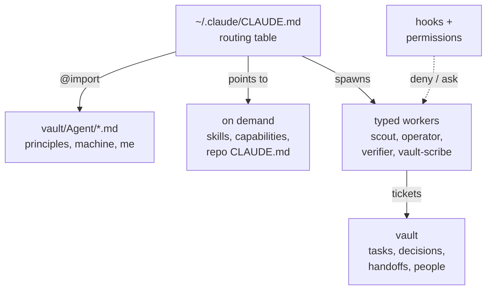

# 1. Architecture: the layers

The setup separates **what the agent should always know**, **what it loads on demand**, **what it remembers**, **where project state lives**, and **what the harness enforces regardless of what the model decides**. Each concern has exactly one owner file; everything else points at it.

## Layer table

| layer | file(s) | loads | owns |
|---|---|---|---|
| global assembly | `~/.claude/CLAUDE.md` | every session | a routing table: "for X, read Y first". No content of its own beyond one line per rule |
| working principles | `vault/Agent/working-principles.md` (`@`-imported) | every session | how to approach any coding task: coverage, evidence, delegation, approvals |
| machine context | `vault/Agent/machine-context.md` (`@`-imported) | every session | OS, shell quirks, package-manager order, paths, aliases |
| about me | `vault/Agent/about-me.md` (`@`-imported) | every session | role, preferences, languages |
| output style | `~/.claude/output-styles/<name>.md`, set in `settings.json` `outputStyle` | every session | the register of replies only: length, claims, how a turn ends |
| repo rules | `<repo>/CLAUDE.md` | cwd in that repo | stack, commands, test setup, deploy target of that repo |
| skills | `~/.claude/skills/<name>/SKILL.md` | when its `description` triggers | a procedure for one recurring job (session start, inbox triage, a review) |
| capabilities | `~/.claude/capabilities/<service>.md` | when the service is touched | how to reach one service: CLI/MCP/API, which identity, where the secret is (by reference), a health command, known failures |
| typed agents | `~/.claude/agents/<name>.md` | when spawned | one role, a tool allowlist, a model, a fixed report format |
| hooks | `~/.claude/hooks/*.sh` wired in `settings.json` | on every matching tool call | rules that must hold even when the model forgets them |
| scripts | `~/.claude/scripts/*.ts` (bun) | run by skills, hooks or you | the agent queue, vault lint, capability doctor and transcript trace (`payload/claude/scripts/README.md`) |
| dispatch contract | `~/.claude/dispatch-protocol.md` | pasted into the brief of any agent that runs unattended | how to behave when nobody watches: no approval-needing commands, fixed report, vault write-back |
| auto-memory | `~/.claude/projects/<slug>/memory/` | per working directory | facts about how to work: tool quirks, access paths, preferences |
| vault | Obsidian | read through files or Bases | project state: tasks, decisions, hand-offs, people, dated analyses |

## Why the prompt files live in the vault and are `@`-imported

- You edit your rules in Obsidian, next to your notes, with backlinks and search.
- `~/.claude/CLAUDE.md` stays a short index (under 5 KB). Long CLAUDE.md files are the most common way prompts rot: content gets duplicated, the duplicates drift, and the model obeys whichever copy it read last.
- Syntax: a line starting with `@` followed by a path, e.g. `@~/Obsidian/Vault/Agent/working-principles.md`. Relative paths resolve from the importing file; `~` works; imports nest up to 5 levels; an `@` inside a code span or code block is not imported. Keep the path free of spaces.
- `/memory` in a session lists what was actually loaded. Check it after every change.
- Joris keeps the same files in `~/.claude/system-instructions/` instead (versioned and tested together with the hooks). Both work; the vault variant is easier to read and edit, the `~/.claude` variant is easier to test. Pick one home per file, never both.

## Two state stores, one owner each

| store | holds | never holds |
|---|---|---|
| auto-memory | how to work: "the staging DB needs the VPN", "this user wants arithmetic done in code" | project status, task lists, dates of meetings |
| vault | project state: tasks, decisions, hand-offs, people, call notes, dated analyses | message or mail content (read live from the channel, never copied) |

A memory that repeats a skill, a capability or a repo doc is a duplicate: replace it with a pointer.

## The vault contract (short)

Full version in `payload/vault/Constitution/vault-schema.md`. The parts agents depend on:

- **Typed notes** by frontmatter `type:` (`project`, `handoff`, `decision`, `daily-note`, `contact`), so Bases views and scripts can query them.
- **Tasks** only in a project's `tracker.md` or a daily note, in the Tasks plugin emoji grammar. Tags carry meaning: `#blocked-on-me` (needs you), `#waiting-on/<person>` (needs someone else), `#agent-ready` + `done when: <observable>` (an agent may pick it up without asking).
- **Decisions** are one note each in `decisions/`, never edited; a change is a new note with `supersedes:`. This is what stops agents re-proposing what you already rejected.
- **Handoff** per project: one screen, sections rewritten whole, the first thing a new session reads.
- **Agent write rules**: line-targeted edits, read right before writing, commit by path (several sessions share the checkout), never `git add -A`.

## First week

1. Work normally. Every time an agent does something you have to correct twice, write one line in `working-principles.md` or the repo's `CLAUDE.md` with the reason.
2. Put each project's open work in its `tracker.md`, and tag one small, well-defined task `#agent-ready` with a `done when:` line. Start a session with "work the next ready task" and see how it goes.
3. When a rule keeps being ignored, do not write it louder: turn it into a hook (stage 2).
