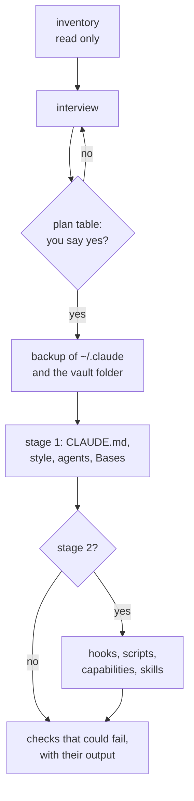

You don't install this by hand. Your own Claude Code agent reads `BOOTSTRAP.md`, interviews you and builds the setup.

```sh
git clone https://github.com/j-shelfwood/agent-setup-blueprint.git ~/Projects/agent-setup-blueprint
cd ~/Projects/agent-setup-blueprint
claude
```

Then type:

> Read BOOTSTRAP.md and set up my machine following it. Interview me first.



> [!info] What it asks you
> Your name and role, your stack, reply and code languages, where your vault and code live, which actions must always be asked first, which stages to install, and which services agents will touch. Machine facts come from the inventory.

> [!warning] Don't clone into an Obsidian vault
> The templates in `payload/vault/` would show up as real notes in your vault.

The full procedure: [BOOTSTRAP.md](https://github.com/j-shelfwood/agent-setup-blueprint/blob/main/BOOTSTRAP.md). After the install, start with week 1 of [[method#Adopting it|adopting the method]].
