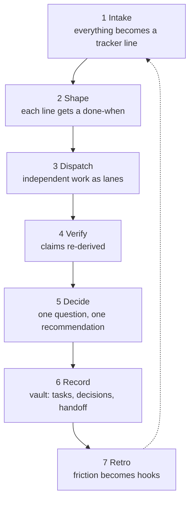

The kit in this repository is the machinery. This page is the way of working it exists for: a loop that turns incoming work into checked, recorded results while **your attention goes only to the decisions that are yours**.

> [!abstract] The premise
> Agents are cheap and parallel; your attention is the scarce resource. Every rule below exists to spend that attention on decisions only: not on rereading agent output, not on re-explaining context, not on answering questions an agent could have settled itself.

## The loop

### 1 Intake

Every request, mail, review comment or idea becomes one line in a project's `tracker.md`. Messages are read live from their channel and never copied in.

- **Leaves behind:** a task line
- **Prevents:** work that lives only in a chat scrollback, and notes that go stale because they copy a conversation
- **In the kit:** [[architecture#The vault contract (short)|vault schema]], `start` skill

### 2 Shape

A line is ready for an agent when it carries `done when: <observable>`, something a command or a page can show. Tag it `#agent-ready`.

- **Leaves behind:** `#agent-ready … done when: …`
- **Prevents:** agents "finishing" work nobody can check, and you re-explaining the goal mid-run
- **In the kit:** `agent-queue.ts`

### 3 Dispatch

Split before acting: one lane inline; independent lanes to typed workers, all in one message; each editing lane in its own worktree, one deliverable per lane. The main agent keeps a lane of its own.

- **Leaves behind:** a lane brief: goal, paths, observable
- **Prevents:** one agent doing five things in sequence, two agents corrupting one checkout
- **In the kit:** [[orchestration#3.1 Fan-out inside one session|fan-out]], typed workers

### 4 Verify

A worker's report is a claim. The main agent reruns the observable, or a `verifier` re-derives it with a different instrument. "Works" needs a check that could have failed.

- **Leaves behind:** `verified: <command> → <result>`
- **Prevents:** a green suite on code that does not work, and a wrong number repeated as fact
- **In the kit:** `verifier`, `reviewer`, operator report gate

### 5 Decide

Reversible work inside what you approved is done, not asked. What is yours (a message to a person, spend, a delete, a product call) reaches you as one question with the recommended option first and the observation that decides it.

- **Leaves behind:** a decision question
- **Prevents:** an inbox of "should I…?" questions, and decisions you have to re-derive from a list of points
- **In the kit:** output style, [[prompting-strategies#7. Approvals split by reversibility, set from data|approvals split]]

### 6 Record

Your answer becomes a decision note (never edited, superseded by a new one); finished work flips its tracker line; the project handoff is rewritten in place.

- **Leaves behind:** decision note, `✅` line, handoff
- **Prevents:** the same idea proposed again next month, and every session starting from zero
- **In the kit:** `vault-scribe`, `vault-lint.ts`

### 7 Retro

Weekly, the agent mines its own transcripts for recurring friction and turns each cluster into a fix with a destination: a hook, a "Known failures" line, a prompt edit.

- **Leaves behind:** a hook or doc change
- **Prevents:** the same mistake corrected by hand for the tenth time
- **In the kit:** `retro` skill, `trace.ts clusters`

## Roles

| role | does | never does |
|---|---|---|
| **You** | set direction, answer decision questions, tag work `#agent-ready` | read raw agent output to find out what happened |
| **Main agent** (the session you talk to) | converse, split into lanes, brief workers, verify their claims, ask you only what is yours | long edits itself when a lane could do them; forward a worker's claim unchecked |
| **Workers** (`scout`, `operator`, `verifier`, `reviewer`, `researcher`, `vault-scribe`) | one role each, a tool allowlist, a fixed short report | talk to you, send messages, widen their scope |
| **The vault** | hold state: tasks, decisions, handoffs, people | hold copies of messages, status prose, plans that were never decided |

## Cadences

| cadence | trigger | what runs |
|---|---|---|
| per session | you open a project | `start`: read the handoff, tracker, git and PRs; propose lanes; run them; verify; record |
| per event | a webhook, a reply, a schedule | a fresh, short-lived agent with the [[orchestration#3.3 The dispatch contract: "work as if nobody is watching"\|dispatch contract]]; it never runs a command that needs approval and reports `Done`, `Partial` or `Blocked` |
| weekly | calendar | `retro` over the transcripts; `vault-lint.ts` for stale handoffs and stray tasks |
| monthly or before a big prompt edit | calendar | `memory-gc`, `prompt-audit` against Anthropic's current guidance |

## Autonomy levels

Move up one level only when the level below runs without you correcting it.

| level | what agents may do without asking | what you need first |
|---|---|---|
| 0 Assisted | nothing; every step is approved | Claude Code |
| 1 Reversible | commits, local files, drafts, feature-branch pushes; reported with the undo command | the approvals split in your working principles, the push guard hook |
| 2 Queue | work `#agent-ready` lines to their `done when:` in a session you start | trackers with observables, typed workers, verification habit |
| 3 Unattended | the same, started by a schedule or an event, with questions sent to a channel you read on your phone | the dispatch contract, worktrees, a bot channel ([[orchestration\|stage 3]]) |

> [!warning] Do not skip a level
> Unattended agents amplify whatever the level below does. If level 2 still needs you to correct reports, level 3 produces those reports while you sleep.

## How you know it works

Measure the method by where your attention goes, not by how much the agents do.

- **Hand-back rate**: of the decision questions you got this week, how many did you answer with "just do it"? Each one is a rule missing from your approvals split. It should trend down.
- **Unchecked claims**: reports that say "works" with no command and output. Should be zero; a hook can enforce the report format.
- **Repeat friction**: clusters from `trace.ts clusters` that survive two retros. Each needs a hook, not another prompt line.
- **Cold starts**: sessions that begin by asking you what was going on. Each one is a stale or missing handoff.

## Anti-patterns

> [!failure] What this method rules out
> - **A long-lived orchestrator thread.** It works from whatever brief and state it read when it started. Fresh, short threads read the current brief and handoff every time, so nothing has to keep a long thread up to date.
> - **A list of questions at the end of a reply.** You have to re-derive the call the agent was best placed to make. One question per decision, recommendation first.
> - **Trusting the green suite.** Tests pass on code that does not do the thing. Observe the running system.
> - **Copying messages into notes.** The copy goes stale; read the channel live and record only the decision.
> - **STATUS.md.** Status that needs discipline to stay true will not. Compute it from typed notes, or keep it as a handoff that a linter checks for freshness.
> - **Writing a rule louder.** A rule the agent keeps breaking becomes a hook.

## Adopting it

| week | do | done when |
|---|---|---|
| 1 | install stage 1 with [[install\|BOOTSTRAP]]; put each project's open work in its `tracker.md` | every project has a tracker and a handoff |
| 2 | shape three small tasks with `done when:` and run them through `start` | three `✅` lines whose observables you saw |
| 3 | install the hooks; note every decision question you answered "just do it" | the approvals split in your working principles is updated |
| 4 | first `retro`; turn the top cluster into a hook | one new hook with a passing test |

Related: [[architecture]] · [[prompting-strategies]] · [[orchestration]]
