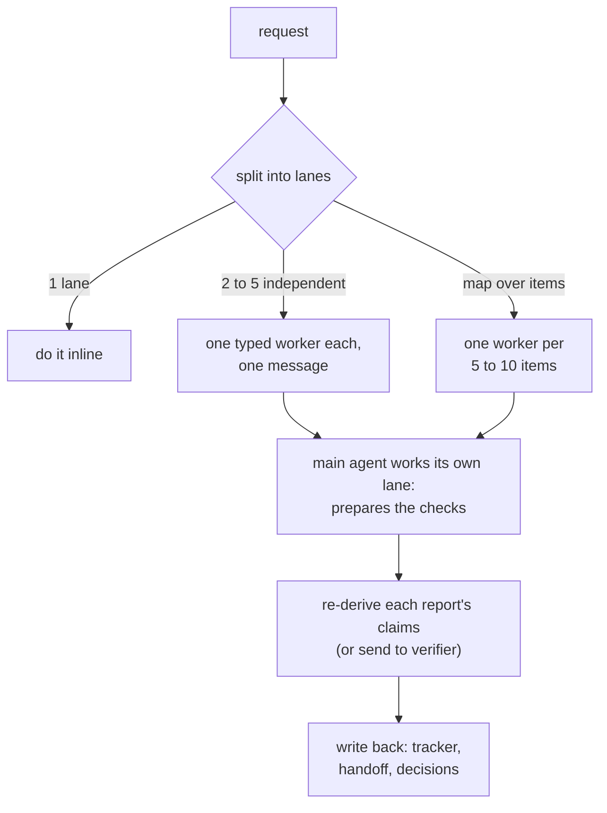
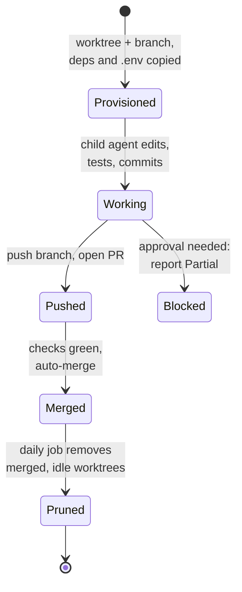
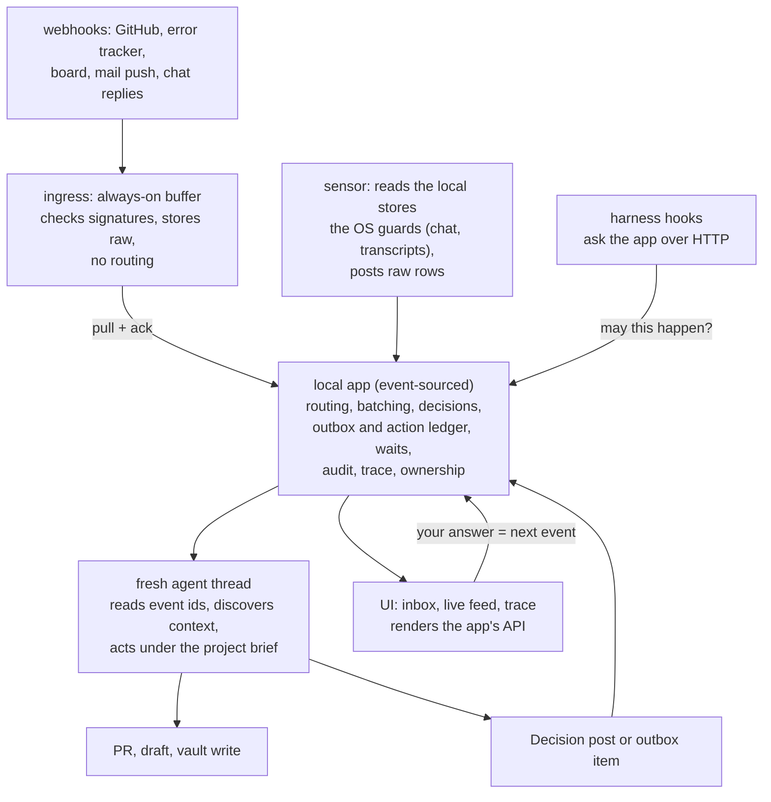

How Joris runs many agents at once without watching each one. It is level 3 of the [[method#Autonomy levels|autonomy levels]]. This is the most custom part of the setup: copy the **patterns**, build the pieces only when stage 1 and 2 are routine.

## 3.1 Fan-out inside one session

Before the first tool call, the main agent splits the request into lanes: independent (disjoint paths, no output feeding another) or dependent.

- One lane: do it inline.
- 2 to 5 independent lanes: one typed worker each, all launched in one message so they run in parallel; read-only waves (scouts) up to 8.
- A map over items (50 mails, 20 files): one worker per 5 to 10 items, each returning one line per item.
- While workers run, the main agent works its own lane: it prepares the checks that will re-derive the workers' claims. A turn that launches agents and then idles is the most common waste.



A `start` skill (`payload/claude/skills/start/`) packages this as a session opener: read the project's handoff, tracker, git state and open PRs, propose the lanes as a table, run the approved ones, review each result.

## 3.2 Parallel lanes that edit code: worktrees

Two agents editing the same checkout corrupt each other's work. Each editing lane gets its own **git worktree** on its own branch, provisioned automatically (dependencies, `.env` copy), and is removed once merged.

Joris uses **T3 Code** (a desktop app that runs Claude Code and Codex threads) as the only runtime that starts agents: `delegate_task` with worktree isolation creates the checkout and branch, the child works there, pushes, opens a PR and reports. A daily job prunes merged, idle worktrees. A hook denies `git worktree add` by hand and launching `claude` from a shell, so there is exactly one way lanes come into being.

Without T3: `git worktree add ../<repo>-<lane> -b <lane>` plus one terminal per lane gives the same isolation by hand.



## 3.3 The dispatch contract: "work as if nobody is watching"

A dispatched agent runs while you are elsewhere; a permission prompt can wait for hours and blocks everything behind it. So every dispatched agent gets a standing contract (Joris's `dispatch-protocol.md`):

- Do not run a command you expect to need approval. On a denied call: do not retry, finish everything else, report `Partial` with the exact gate.
- Commit before any step that might block.
- Never send a message to a person; draft it and say where.
- End with a fixed report: `Done | Blocked | Partial`, what changed (files, branch, PR), what ran and what it printed, what was deliberately not done.
- Durable outcomes go to the vault: a tracker line flipped to done, one log line in the daily note, a decision note.

## 3.4 A private chat channel per project

Agents need a place to ask you things that reaches your phone. Joris self-hosts **Mattermost**:

- One private channel per project, `fleet-<project>`, with exactly two members: you and a **bot account** the agents post as.
- The channel carries only **Decision posts**: the question, the recommended option, what it blocks, and a link to the thread that asked. Summaries stay in the agent's final report.
- You answer in the post's thread, from your phone. The reply comes back to the agents as an event ([[#3.5 Events start agents: the fleet|3.5]]).
- Two identities: agents post as the bot; a separate **read-only** connection reads your own unread messages and rejects writes. Your personal token is never used to post.
- A gate in code (a hook on every chat write) checks that the bot only writes in a channel where you and it are the only members.
- **Outbox**: every outgoing mail an agent prepares waits as an outbox item with the exact send (recipients, subject, body). You approve, reject or comment, in an outbox channel or in the app's inbox; only the session that claims your approval sends it, still behind the harness prompt, and records the sent message id. The outbox is part of the local app ([[#3.5 Events start agents: the fleet|3.5]]), so "was this mail sent?" has one answer.

The round trip of one Decision:


Any chat tool with a bot API works (Slack, Discord, Matrix, Telegram). What matters is: a bot identity separate from yours, one channel per project, and a gate that restricts where the bot can write.

## 3.5 Events start agents: the fleet

Instead of one long-running orchestrator, every event starts a **fresh, short-lived thread** (decision D4 in Joris's fleet: a fresh thread is short and always reads the current project brief, so the hand-over between runs and the check for an outdated brief could both be deleted). The cost, recorded in the same design notes: every thread reads the conversation cold and paraphrases it, so what a post must carry has to be written down.

Deciding what an event means, and which outward actions may happen, belongs to **one local app**. Agents, hooks and the UI talk to it over HTTP; none of them decides.



### One owner per question

The first version of this was a set of loose scripts: a router, an outbox CLI, a trace builder, an audit, each reading and writing its own files. It worked until the scripts disagreed. "Was this mail sent?", "what waits on me?" and "is this decision settled?" each had three to six answers (a script, a hook's own ledger, a line in the brief, a port of the script in the router), and an agent acted on whichever it read. The fix was ownership, not language: one app answers each question, and everything else asks it.

| concern | owner | the others |
|---|---|---|
| routing, batching, which thread owns a subject | the local app | the sensor posts raw rows; it derives no project |
| outgoing mail and other outward actions (merge, deploy, delete) | the app's outbox and action ledger: each action has a recorded basis, an approval, and the id of what it did | a hook asks the app before a send; an agent never sends what has no basis |
| what waits on you, whether a Decision is settled | the app's event log | the UI and the agents read it over the API |
| project state (tasks, decisions, handoffs) | the vault | the app reads and writes it as a storage disk, with the same rules as an agent |
| gates every session needs (push, merge, destructive git, the text rules of a send) | local hooks | they keep working with the app down |

### Design rules worth copying

- **Events first.** The app is event-sourced: every answer it gives is an event in its store, so a replay rebuilds its state without re-running actions, and an audit reads the same log.
- **The vault and the state folder are storage disks** of the app, not databases of their own. Nothing else writes to the state folder.
- **Agents and hooks talk HTTP through one thin client** (`curl` from bash is enough), never by booting the app's CLI from a worktree: a worktree carries test settings, and a CLI boot is slower than a local request.
- **A fail policy per endpoint.** With the app down, a send from a dispatched session is denied; in a session you are watching, the app's half of the gate falls back to your permission prompt. Decision posts spool locally and post when it is back. Reads serve the last snapshot.
- **Gates that guard every session stay local**: they must not depend on the app being up, and a gate that blocks when the app is down would also block its repair.
- **The ingress holds no logic**: it checks signatures, stores the raw request and waits to be pulled.
- **The UI is a front end.** It renders what the app's API returns. The one thing it does besides that is act as the sensor for stores the OS lets only a signed app read (a chat app's database, a transcription app's files): it reads them and posts raw rows, and the app classifies them.
- **Parity, then delete.** When logic moves from a script into the app, the old script is deleted in the same change, after a parity check by an agent that did not write the replacement. Two strategies running side by side are how the six answers came about.
- Threads you started yourself are yours: the fleet never sends into them.
- A count-triggered **audit** (after N events in a project) checks the agents' own recent work, and a weekly status run drafts the client update, as an outbox item.
- No model runs while nothing happens.

A hook that needs the app asks it in a few lines of bash; the answer is the decision, and the fail policy decides when there is no answer:

```bash
# PreToolUse hook, fleet half of a send gate: ask the local app, fall back per the fail policy.
ANS=$(curl -sS -m 2 -H "Authorization: Bearer $APP_TOKEN" -H 'Content-Type: application/json' \
  -d "$(jq -c '{tool: .tool_name, tool_input}' <<<"$INPUT")" http://localhost:8000/api/actions/check) || ANS=''
if [ -z "$ANS" ]; then
  [ -n "$DISPATCHED" ] && DECISION=deny || DECISION=ask   # app down: deny unattended, ask when watched
else
  DECISION=$(jq -r '.decision' <<<"$ANS")                 # allow | ask | deny, with .reason
fi
```

Joris's implementation is three repos: a Laravel webhook buffer on a server; a Laravel app on the laptop (event sourcing on Postgres, run by launchd, pushing changes to the UI over websockets) that owns every gate and event-driven behaviour above; and a repo with the fleet brief and the desktop app (inbox, live feed, trace views), which is the front end and the sensor. It is a lot of machinery; a cron job that runs `claude -p "work the next #agent-ready task in <repo>"` once an hour is a reasonable first version of the same idea. When you outgrow it, start the app with the outbox: it is the question whose wrong answer costs most.

## 3.6 Seeing what happened: trace and health

- **Session trace**: a parser over `~/.claude/projects/**/*.jsonl` (and subagent transcripts) producing events, stats and a per-project brief. Here: `bun ~/.claude/scripts/trace.ts sessions --since 7d` (per-session tool calls, errors, hook denials, interrupts, rejections) and `trace.ts clusters` (recurring error signatures, the input of the `retro` skill). Joris's own `claude-trace` adds a UI over the same data.
- **Fleet trace**: once the local app exists, its event log is the trace of the fleet: which event started which thread, what it changed, what waits on you. The UI reads it from the app's API and decides nothing.
- **Doctor**: reads the `health` line of every capability file at session start and prints only the red rows, so an agent knows a service is down before it tries it. Here: `~/.claude/scripts/doctor.ts`, run by the `session-start-doctor.sh` hook.
- **Estate status**: one command that reports the health of every deployed service; agents run it before any curl or ssh, because ad-hoc probing produced false alarms.
- **Agent queue**: a script lists open tracker lines tagged `#agent-ready` with a `done when:` line, sorted by priority. That list is what an unattended agent may pick up. Here: `bun ~/.claude/scripts/agent-queue.ts`.

## 3.7 What to build first, in order

1. Typed workers and the fan-out rule (no infrastructure).
2. The `#agent-ready` + `done when:` convention in your trackers.
3. Worktrees per editing lane.
4. A bot + one private channel per project for Decision posts.
5. A scheduled run per project that works the queue.
6. Only then: webhooks into a buffer, one local app that owns the gates and events (start with the outbox), a UI over its API.
