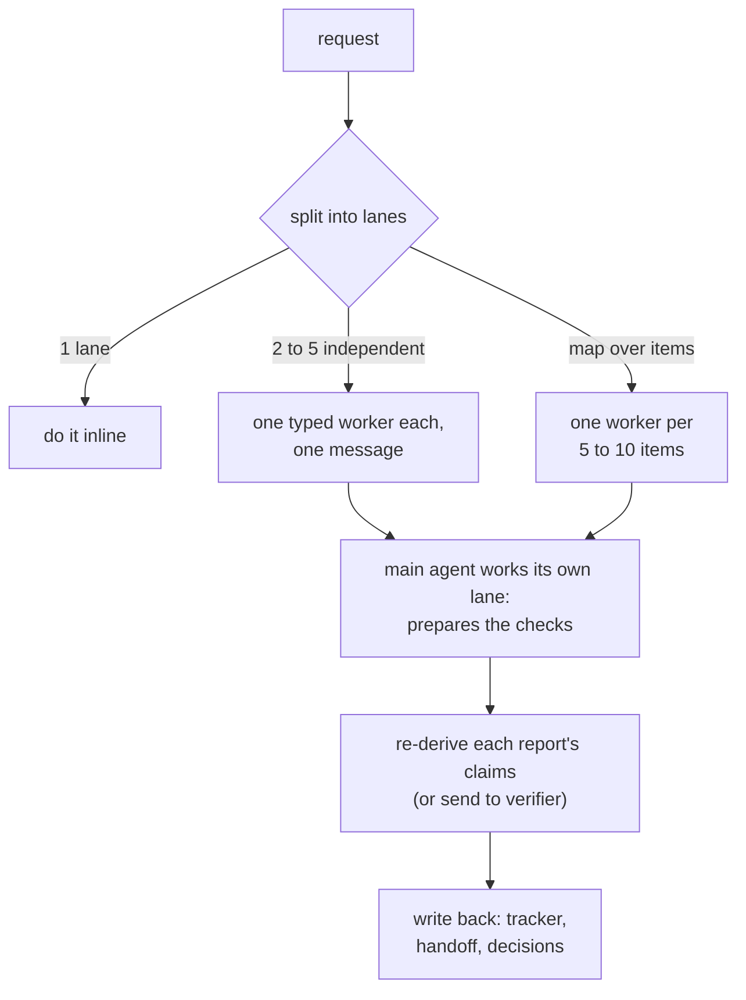
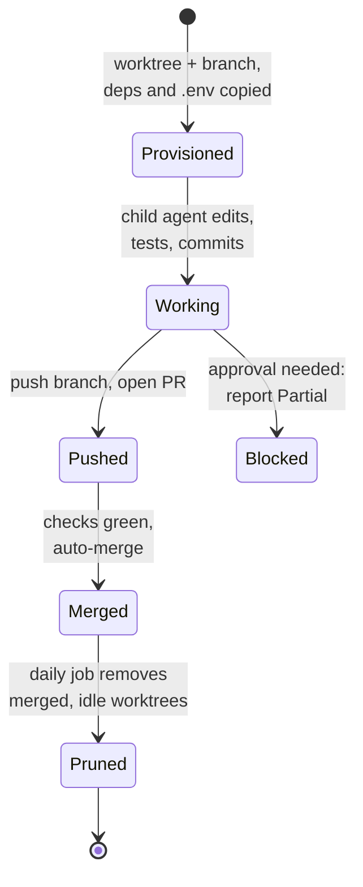
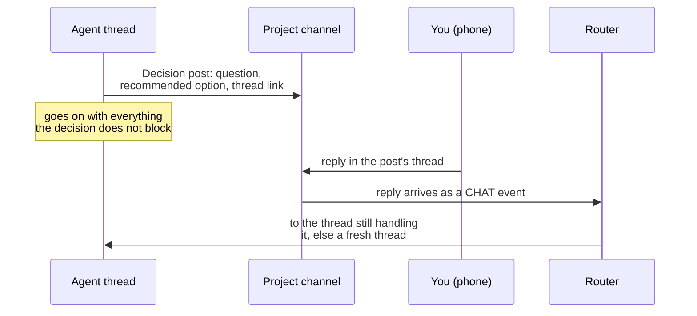
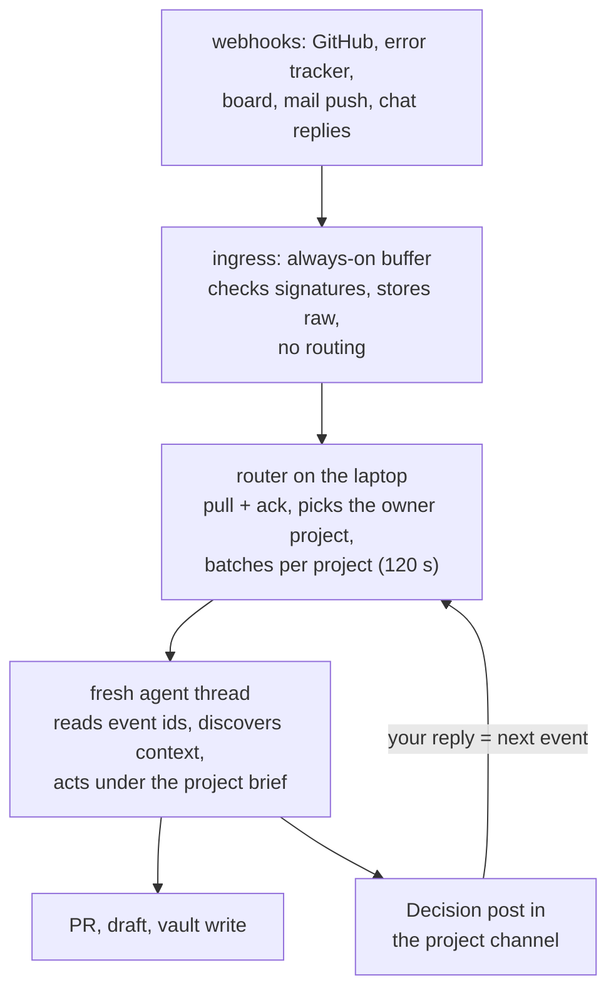

# 3. Orchestration (stage 3, optional)

How Joris runs many agents at once without watching each one. This is the most custom part of the setup: copy the **patterns**, build the pieces only when stage 1 and 2 are routine.

## 3.1 Fan-out inside one session

Before the first tool call, the main agent splits the request into lanes: independent (disjoint paths, no output feeding another) or dependent.

- One lane: do it inline.
- 2 to 5 independent lanes: one typed worker each, all launched in one message so they run in parallel; read-only waves (scouts) up to 8.
- A map over items (50 mails, 20 files): one worker per 5 to 10 items, each returning one line per item.
- While workers run, the main agent works its own lane: it prepares the checks that will re-derive the workers' claims. A turn that launches agents and then idles is the most common waste.

A `start` skill (`payload/claude/skills/start/`) packages this as a session opener: read the project's handoff, tracker, git state and open PRs, propose the lanes as a table, run the approved ones, review each result.

## 3.2 Parallel lanes that edit code: worktrees

Two agents editing the same checkout corrupt each other's work. Each editing lane gets its own **git worktree** on its own branch, provisioned automatically (dependencies, `.env` copy), and is removed once merged.

Joris uses **T3 Code** (a desktop app that runs Claude Code and Codex threads) as the only runtime that starts agents: `delegate_task` with worktree isolation creates the checkout and branch, the child works there, pushes, opens a PR and reports. A daily job prunes merged, idle worktrees. A hook denies `git worktree add` by hand and launching `claude` from a shell, so there is exactly one way lanes come into being.

Without T3: `git worktree add ../<repo>-<lane> -b <lane>` plus one terminal per lane gives the same isolation by hand.

## 3.3 The dispatch contract: "work as if nobody is watching"

A dispatched agent runs while you are elsewhere; a permission prompt can wait for hours and blocks everything behind it. So every dispatched agent gets a standing contract (Joris's `dispatch-protocol.md`):

- Do not run a command you expect to need approval. On a denied call: do not retry, finish everything else, report `Partial` with the exact gate.
- Commit before any step that might block.
- Never send a message to a person; draft it and say where.
- End with a fixed report: `Done | Blocked | Partial`, what changed (files, branch, PR), what ran and what it printed, what was deliberately not done.
- Durable outcomes go to the vault: a tracker line flipped to done, one log line in the daily note, a decision note.

## 3.4 A private chat channel per project

Agents need a place to ask you things that reaches your phone. Joris self-hosts **Mattermost**:

- One private channel per project, `fleet-<project>`, with exactly two members: you and a **bot account** the agents post as.
- The channel carries only **Decision posts**: the question, the recommended option, what it blocks, and a link to the thread that asked. Summaries stay in the agent's final report.
- You answer in the post's thread, from your phone. The reply comes back to the agents as an event (3.5).
- Two identities: agents post as the bot; a separate **read-only** connection reads your own unread messages and rejects writes. Your personal token is never used to post.
- A gate in code (a hook on every chat write) checks that the bot only writes in a channel where you and it are the only members.
- **Outbox**: mail an agent prepared in an unwatched session is posted to an outbox channel with the exact send; you approve, reject or comment there, and only then does a session send it, still behind the harness prompt.

The round trip of one Decision:

Any chat tool with a bot API works (Slack, Discord, Matrix, Telegram). What matters is: a bot identity separate from yours, one channel per project, and a gate that restricts where the bot can write.

## 3.5 Events start agents: the fleet

Instead of one long-running orchestrator, every event starts a **fresh, short-lived thread** (decision D4 in Joris's fleet: a fresh thread is short and always reads the current project brief, so the hand-over between runs and the check for an outdated brief could both be deleted). The cost, recorded in the same design notes: every thread reads the conversation cold and paraphrases it, so what a post must carry has to be written down.

Design rules worth copying:

- The ingress holds no logic; the router is event-sourced, so a replay rebuilds its state without re-running actions.
- Threads you started yourself are yours: the fleet never sends into them.
- A count-triggered **audit** (after N events in a project) checks the agents' own recent work, and a weekly status run drafts the client update for approval.
- No model runs while nothing happens.

Joris's implementation is three repos (a Laravel buffer, a Laravel router, a Bun umbrella with the brief and a desktop app). It is a lot of machinery; a cron job that runs `claude -p "work the next #agent-ready task in <repo>"` once an hour is a reasonable first version of the same idea.

## 3.6 Seeing what happened: trace and health

- **Session trace**: a parser over `~/.claude/projects/**/*.jsonl` (and subagent transcripts) producing events, stats and a per-project brief. Joris's `claude-trace` and the Fleet Trace app show every run, what it changed, and what is waiting on him.
- **Doctor**: reads the `health` line of every capability file at session start and prints only the red rows, so an agent knows a service is down before it tries it.
- **Estate status**: one command that reports the health of every deployed service; agents run it before any curl or ssh, because ad-hoc probing produced false alarms.
- **Agent queue**: a script lists open tracker lines tagged `#agent-ready` with a `done when:` line, sorted by priority. That list is what an unattended agent may pick up.

## 3.7 What to build first, in order

1. Typed workers and the fan-out rule (no infrastructure).
2. The `#agent-ready` + `done when:` convention in your trackers.
3. Worktrees per editing lane.
4. A bot + one private channel per project for Decision posts.
5. A scheduled run per project that works the queue.
6. Only then: webhooks, a router, a trace UI.
