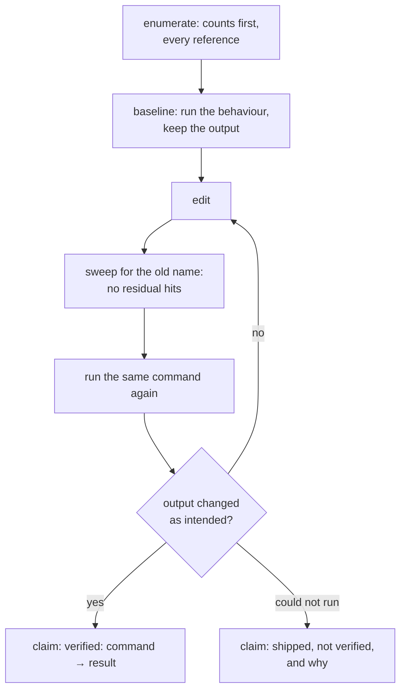
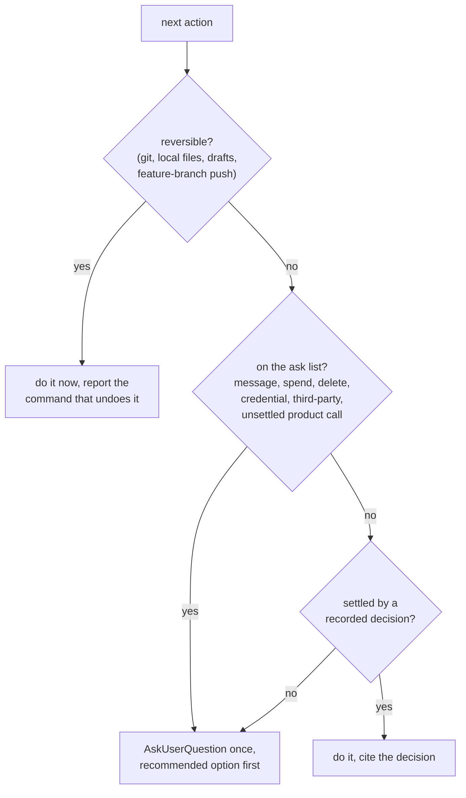
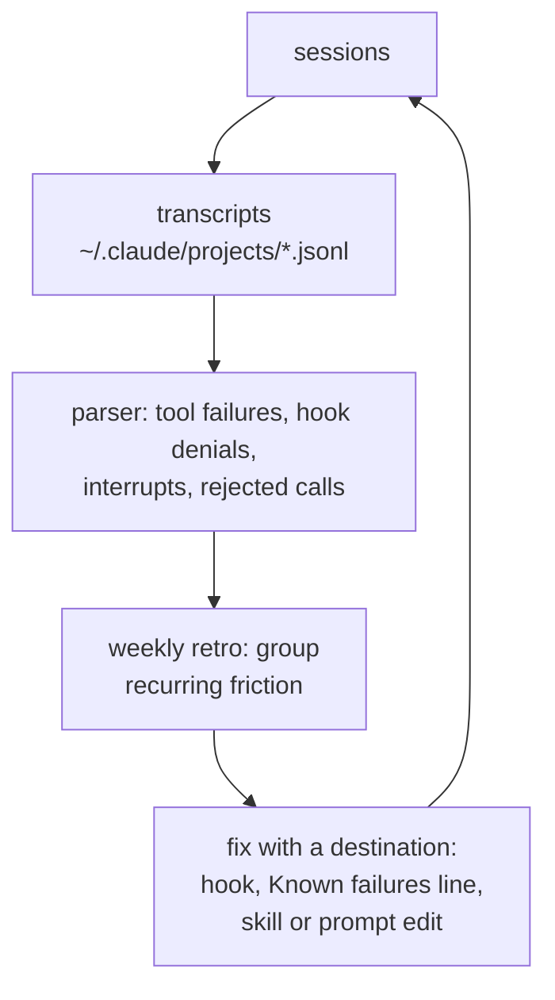

# 2. Prompting strategies

The rules below came out of reading months of Joris's own session transcripts and counting what went wrong. Each one names the failure it prevents; keep the reason next to the rule when you adapt it, because a rule without its reason gets deleted or over-applied by the next editor (human or model).

## 1. Write prompts as an assembly, not a manual

- The global `CLAUDE.md` is a **routing table**: one line per rule, pointing at the file that owns the detail. "Any API key or token: the `credentials` skill first." "Health of a deployed service: run `<status command>`, never curl."
- Content lives once. When two files say the same thing, they will drift and the model follows whichever it read last.
- Skills load by trigger words in their `description`, so the always-on context stays small. A skill's description is a list of the phrases you actually type.
- **Gates are harness-enforced, prose never substitutes.** A rule that matters (never force-push, never send mail unasked) is a permission rule or a hook. The prose line only explains it.

## 2. Two failure modes, two defences

From the working principles (`payload/vault/Agent/working-principles.md`):

- **Incompleteness**: one of five call sites changed. Defence: enumerate before editing (`rg -l`, counts first), and sweep for the old name after.
- **Ungrounded confidence**: every edit is right, the suite is green, and it still does not work. Defence: observe the running system. A claim carries its instrument: `verified: <command> → <observed result>`, or `inferred`, or `assumed`. "Works", "fixed" and "live" require a check that could have failed.

## 3. Counts before reads

`rg -c`, `rg -l | wc -l`, `rg -o '<pat>' | sort | uniq -c` give the shape of a problem for a fraction of the tokens of opening one file. Agents that read five candidate files to learn what one counting pass shows also miss the sixth.

## 4. Absence claims need two instruments

"Missing", "empty", "unused", "does nothing" are the claims most often wrong. Require a second, different check (a DOM query against the source, a DB aggregate, a grep against the running system) before writing one down. Before reporting bad data, check in this order: stale local copy, a deliberate decision someone recorded, then a real defect.

## 5. A subagent's finding is not evidence

When the main agent repeats a worker's number, the claim becomes its own but the observation does not. It re-derives the number from the source or attributes it. A dedicated `verifier` worker exists for this: it gets the claim and where the claimant looked, and must pick a different instrument.

## 6. Typed workers with report budgets

Generic subagents returned 5,000 to 14,000 characters of unstructured prose (measured over 681 spawns in 30 days). Typed workers fix that:

| worker | model | tools | returns |
|---|---|---|---|
| scout | cheapest | read-only | counts, paths, short excerpts; 14 lines max |
| operator | strongest | all except sending | Status / Changed / Grounding / Observed / Not done; 20 lines max |
| verifier | strongest | read-only | `REVERIFIED`, `REFUTED` or `UNDECIDABLE` + the command |
| vault-scribe | mid | vault files | one line per ticket + the commit |

A hook denies untyped spawns, so the rule holds even when the model forgets it.

## 7. Approvals split by reversibility, set from data

- **Reversible work** (git commits, local files, drafts, a push to your own feature branch) is done without asking and reported with the command that undoes it.
- **Asked once**: a message to a person, spend, deleting data, a credential only you can issue, a client or third-party system, a product call no recorded decision settles.
- Joris set this split from his own transcripts: of the pushes that prompted, 2 of 119 were rejected; of message sends, 45 of 111. Asking about pushes was noise; asking about messages was necessary. Count your own before copying the thresholds.

## 8. Decisions are a dialog with a recommendation

When the agent needs a decision, it uses the AskUserQuestion tool, one question per decision, **its recommended option first** so Enter accepts it, the option's description being the observation that decides it. Never a list of open points in chat for the user to sort out. "Want me to…?" is not a recommendation.

## 9. The register shapes everything downstream

The output style (`payload/claude/output-styles/operational-spec.md`) keeps replies short and answer-first, and bans filler and em dashes. The reason is not taste: whatever register the agent writes in ends up in memory files and notes, and those are read back at the highest-attention position of a later session, where they set that session's voice. Memories and hand-offs are therefore written as facts, no narration, no first person.

## 10. Prompts cite their own numbers

Rules carry the measurement that motivated them ("41% of editing operators ran a probe before their first edit"). A model follows a rule with a reason and a stake more reliably than an absolute, and the next editor can see whether the rule still earns its place.

## 11. Close the loop on your own transcripts

- Claude Code writes every session to `~/.claude/projects/<slug>/*.jsonl`. A small script (Joris's is `claude-trace`, a TypeScript parser) turns them into events: tool failures, hook denials, interrupts, rejected tool calls.
- A weekly **retro** groups recurring friction and turns each cluster into a fix with a destination: a hook, a line in a capability's "Known failures", a skill edit.

- A **prompt-audit** fetches Anthropic's current prompting guidance before any large rewrite of a prompt file, and scores transcripts against the output style to see whether a rule is followed at all.

## 12. Documentation that carries its own decay mechanism

From `payload/vault/Constitution/documentation-temperaments.md`: a document that needs discipline to stay true rots; one whose structure shows its age survives. So: analyses carry the date in the filename, decisions are append-only with `supersedes:`, the handoff is the only replace-in-place note and is linted for freshness, and status is computed (a Bases view), never hand-written. No `STATUS.md`, `TASKS.md` or `BACKLOG.md`.

## 13. Compaction is a prompt too

Long sessions are summarised. A `## Compact Instructions` section in `CLAUDE.md` sets the shape of that summary (state, ledger of what changed and was verified, every standing instruction the user gave, verbatim), so the next context window does not lose a "do not push" or invent a "the user approved".
