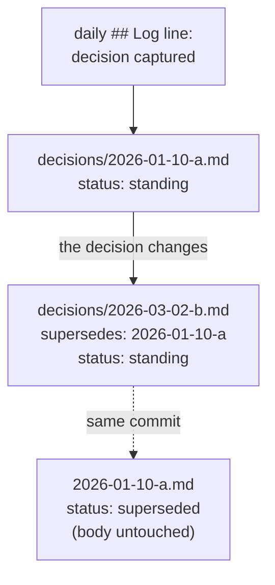
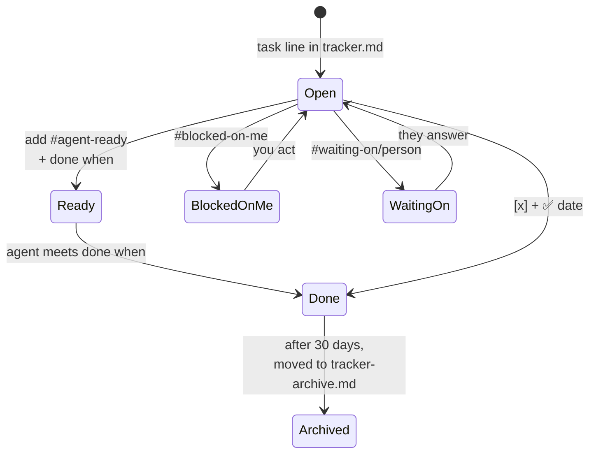

# Vault schema

The contract between this vault, its Bases views and the agents that write to it. Anything not specified here is free-form prose; anything specified here is load-bearing, because views and scripts break silently when it drifts. Signals (incoming messages, mail, chat) are not stored in the vault: agents read them live from their source. The vault is the state layer.

## 1. Folder → type

| folder | `type` | purpose |
|---|---|---|
| `Constitution/` | `schema` | this file and the doctrine |
| `<<AGENT_DIR>>/` | none | prompt files `@`-imported by `~/.claude/CLAUDE.md` |
| `Projects/<P>/` | `project`, `handoff`, `decisions`, `decision`, artifacts | one folder per project or client engagement |
| `Network/` | `contact`, `organization` | people and organisations |
| `Resources/` | none | reference material, frontmatter optional |
| `Timeline/` | `daily-note` | one note per day, `DD-MM-YYYY.md` |
| `Templates/` | none | Templater sources, excluded from queries |

## 2. Type contracts

**project** (`Projects/<P>/<P>.md`): `type: project`, `status` (`active` · `on-hold` · `done` · `archived`), `client` (slug), `start_date`, `tags`, optional `signals:` (where this project's live sources are: `repo: ~/Projects/<dir>`, chat channel id, mail search query; read live, never copied).

**handoff** (`Projects/<P>/handoff.md`): `type: handoff`, `project: '[[P]]'`, `updated: 'YYYY-MM-DD'`. Sections in order: `## State` (an `As of YYYY-MM-DD` line, then bullets), `## Next` (what · owner · date), `## Communication` (one line per person), `## Open questions`. One screen: at most 40 visible lines, bullets of about 20 words, longer detail in a collapsed callout `> [!note]- Title`. Sections are rewritten whole, never appended. The first thing a new session reads.

**decision** (`Projects/<P>/decisions/YYYY-MM-DD-slug.md`): `type: decision`, `project`, `date`, `title` (the decision as a sentence), `status` (`standing` · `superseded`), `supersedes` (optional wikilink), `summary` (statement and why, one line), `decided_by` (`<<name-slug>>` or `agent`). Body: the statement, who chose it with their words quoted verbatim, `Source:` (link to the message, call note or PR). The body is never edited: a changed decision is a new note with `supersedes:`, and the older note's `status` becomes `superseded` in the same commit. `decisions.md` in the project folder is the index (a Bases view), holding no entries itself.



**daily-note** (`Timeline/DD-MM-YYYY.md`): `type: daily-note`, `date: YYYY-MM-DD` (the machine key; the filename is display). Body: `## Tasks` then `## Log`. The Log takes curated entries only: a decision, a call link, a dated fact. No session receipts, no copied messages.

**contact** (`Network/<Full Name>.md`): `type: contact`, `status`, `organization: '[[Org]]'`, `role`, `emails` (join key for mail), `chat` (join key for chat). Optional `## How to write to` section: tone and language for messages drafted to this person.

**artifacts** (analyses, audits, plans, call notes in `Projects/<P>/`): filename `slug-YYYY-MM-DD.md`, frontmatter `project: '[[P]]'`, `summary` (one line), `status` (`draft` · `current` · `superseded` · `archived`).

## 3. Task grammar (Tasks plugin, emoji format)

```
- [ ] <description> [#tag …] [⏫|🔼|🔽] [🛫 start] [⏳ scheduled] [📅 due]
- [x] <description> … ✅ YYYY-MM-DD
```

Placement: open tasks live only in a project's `tracker.md` or a daily note's `## Tasks`. Tasks anywhere else are content, not commitments. Finished lines older than 30 days move verbatim to `tracker-archive.md` beside the tracker, so the tracker stays short; archive lines are history, never edited.

Semantic tags:

| tag | meaning |
|---|---|
| `#blocked-on-me` | needs <<NAME>>; 🛫 hides it until the start date |
| `#waiting-on/<slug>` | needs someone else; `<slug>` matches a `Network/` note |
| `#agent-ready` | an agent may take it without asking; the line must carry `done when: <observable>` |

Example of a ready task:

```
- [ ] Add CSV export to the invoices page #agent-ready done when: GET /invoices.csv returns 200 with a header row and a test covers it 🔼
```

Agents record deferred human actions and external blockers as tagged tasks before ending a session, not as end-of-turn prose.



## 4. Linking and naming

- Wikilinks in YAML values are single-quoted: `project: '[[Acme]]'`.
- Basenames are unique vault-wide (except `tracker`, `handoff`, `decisions`, `README`, `CLAUDE`).
- Dated artifacts carry the date in the filename. An undated analysis is presumed stale.

## 5. Write rules for agents

1. A session whose working directory is outside the vault writes through the `vault-scribe` worker.
2. Line-targeted edits only. Never re-serialize a whole note or its frontmatter.
3. Read the file immediately before writing; several sessions share the checkout.
4. Task done = `[ ]` → `[x]` + `✅ YYYY-MM-DD`; nothing else on the line changes.
5. Daily-note appends go under the existing `## Tasks` / `## Log`; create the day from `Templates/Daily Note.md` if absent.
6. Section replace is allowed only in `handoff.md`.
7. Commit your own paths in the turn you write them: `git add <paths>`, never `git add -A`.
8. Never create `STATUS.md`, `TASKS.md` or `BACKLOG.md`.
